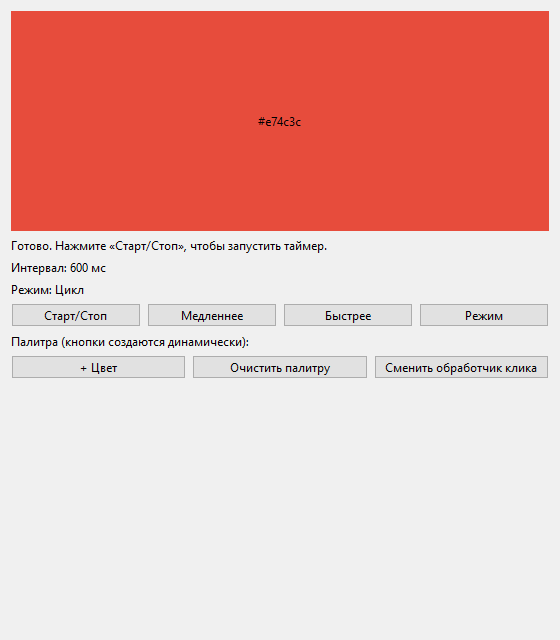
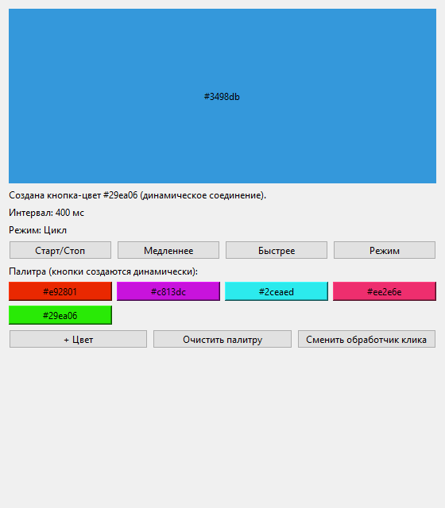

# Лабораторная работа №3. QTimer, лямбда-слоты и динамические соединения

## Описание

**ColorSwitcher** — Qt Widgets приложение, в котором цвет холста меняется
по таймеру в одном из трёх режимов: «Цикл», «Случайный», «Мигание».
Пользователь управляет таймером и интервалом, листает палитру кликами мыши,
добавляет кнопки-цвета во время работы программы и переключает обработчик
сигнала холста «на лету».

В работе используются:

- `QTimer` — периодическое срабатывание сигнала `timeout()`;
- лямбда-функции в качестве слотов с захватом `this` и контекстом
  подключения;
- `QMetaObject::Connection` — хранение, разрыв и пересоздание соединений;
- динамические соединения для кнопок, созданных во время работы;
- переопределение `mousePressEvent()` и собственный сигнал
  `colorChanged(QColor)` (связка «событие → сигнал»);
- `QPointer` и `deleteLater()` для безопасного удаления кнопок.

## Структура проекта

```
ColorSwitcher/
├── .gitignore
├── README.md
├── ColorSwitcher.pro
├── main.cpp
├── colorwidget.h       холст: палитра, отрисовка, клики мыши
├── colorwidget.cpp
├── palettebutton.h     кнопка, хранящая цвет
├── palettebutton.cpp
├── mainwindow.h        главное окно: таймер, режимы, соединения
└── mainwindow.cpp
```

## Сборка и запуск

Требуется Qt 6 (проверено на Qt 6.12.0, MinGW 64-bit).

**Qt Creator:** открыть `ColorSwitcher.pro`, выбрать комплект
*Desktop Qt 6.12.0 MinGW 64-bit*, затем Build → Run qmake →
Rebuild All → Run.

**Командная строка (Windows):**

```bat
set PATH=C:\Qt\6.12.0\mingw_64\bin;C:\Qt\Tools\mingw1310_64\bin;%PATH%
mkdir build
cd build
qmake ..\ColorSwitcher.pro
mingw32-make
release\ColorSwitcher.exe
```

Путь `C:\Qt` заменить на каталог, куда установлен Qt.
Благодаря `CONFIG += console` вместе с окном открывается консоль
с журналом `qDebug()`.

## Управление

| Элемент | Действие |
|---|---|
| Старт/Стоп | запуск и остановка таймера (`start()` / `stop()`) |
| Медленнее / Быстрее | интервал ±200 мс (от 50 до 5000 мс) |
| Режим | Цикл → Случайный → Мигание, с переподключением `timeout` |
| ЛКМ / ПКМ по холсту | следующий / предыдущий цвет палитры |
| + Цвет | создать кнопку-цвет и динамическое соединение для неё |
| Кнопка-цвет | добавить её цвет в палитру холста |
| Очистить палитру | разорвать соединения, удалить кнопки, сбросить палитру |
| Сменить обработчик клика | `colorChanged` → строка статуса или заголовок окна |

## Пример работы

Окно после запуска:



После добавления кнопок-цветов:



Фрагмент журнала:

```
[CREATE] ColorWidget, палитра: 6
[TIMER] start(), interval = 600
[TIMER] timeout, режим = "Цикл" , цвет = "#e67e22"
[TIMER] interval -> 400
[TIMER] режим -> "Случайный" (переподключение timeout)
[TIMER] timeout, режим = "Случайный" , цвет = "#9b59b6"
[TIMER] режим -> "Мигание" (переподключение timeout)
[TIMER] stop()
[MOUSE] Левый клик по холсту
[MOUSE] Правый клик по холсту
[CREATE] PaletteButton "#e92801"
[DYNAMIC] создано соединение для "#e92801" , всего динамических: 1
[PALETTE] Добавлен цвет "#e92801" , всего: 7
[DYNAMIC] нажата кнопка-цвет "#e92801"
[CANVAS] переподключение colorChanged, альтернатива = true
[DYNAMIC] очищена палитра, разорвано соединений: 5
[DESTROY] PaletteButton "#e92801"
[DESTROY] MainWindow
[DESTROY] ColorWidget
```

## Контрольные вопросы

### 1. Что такое QTimer и какой сигнал он излучает по истечении интервала?

`QTimer` — класс Qt для выполнения кода через заданный интервал
в миллисекундах. По истечении интервала он излучает сигнал `timeout()`.

### 2. Чем start() отличается от start(ms) и от QTimer::singleShot()?

`start()` запускает таймер с текущим `interval()`. `start(ms)` сначала
устанавливает новый интервал, а затем запускает таймер. `singleShot()` —
статический метод для однократного вызова без создания объекта `QTimer`.

### 3. Почему QTimer не работает без app.exec()? Что такое цикл событий?

Цикл событий — это цикл внутри `app.exec()`, который получает и
обрабатывает события (таймеры, клики, перерисовку). Таймер срабатывает
только когда цикл событий обнаруживает истечение интервала, поэтому
без `exec()` сигнал `timeout()` не придёт.

### 4. Чем GUI-приложение с таймером отличается от калькулятора ЛР1?

В ЛР1 программа сама ждала ввод в блокирующем цикле `while`, поэтому
цикл событий не был нужен. GUI-приложение управляется событиями: оно
ничего не ждёт само, а реагирует на сигналы и события из `app.exec()`.

### 5. Что будет, если лямбда захватывает this, но контекст не передан?

Соединение не будет привязано к объекту. После уничтожения окна сигнал
всё равно вызовет лямбду, которая обратится к удалённому `this`, что
приведёт к неопределённому поведению или падению программы.

### 6. Зачем третий аргумент connect() и как он связан с деревом ЛР2?

Контекстный объект определяет время жизни соединения: при его удалении
Qt автоматически разрывает соединение. Обычно это `this` или объект из
дерева объектов, который удаляется вместе с родителем.

### 7. Чем захват [=] отличается от [&]? Когда [&] опасен?

`[=]` копирует внешние переменные в лямбду, `[&]` хранит ссылки на них.
`[&]` опасен, если лямбда вызывается после выхода из области видимости
переменной: ссылка становится висячей.

### 8. Что такое QMetaObject::Connection и как разорвать соединение?

Это идентификатор соединения, который возвращает `connect()`. Его можно
сохранить в поле и затем вызвать `disconnect(conn)`, чтобы разорвать
именно это соединение.

### 9. Что такое Qt::UniqueConnection и какую проблему решает?

Флаг для `connect()`, запрещающий создавать повторное одинаковое
соединение между теми же сигналом и слотом. Он защищает от многократного
вызова слота на один сигнал. Для лямбд этот флаг не работает.

### 10. Что будет, если вызвать одинаковый connect() дважды?

Будет создано два соединения, и слот выполнится дважды на каждый сигнал.
Например, цвет холста будет перескакивать через позицию.

### 11. Рвёт ли Qt соединения при удалении отправителя/получателя/контекста?

Да. При уничтожении отправителя, получателя или контекстного объекта
Qt автоматически разрывает все связанные с ним соединения.

### 12. Почему для удаления динамической кнопки лучше deleteLater()?

Кнопка может ещё участвовать в обработке сигнала или события.
`deleteLater()` откладывает удаление до возврата в цикл событий, когда
объект уже точно не используется.

### 13. Чем mousePressEvent() отличается от clicked()? Можно ли connect?

`mousePressEvent()` — виртуальный метод-обработчик низкоуровневого
события, его переопределяют в подклассе. `clicked()` — сигнал, к нему
подключаются через `connect()`. К событию подключиться через `connect()`
нельзя.

### 14. Что такое eventFilter() и когда он удобнее?

`eventFilter()` позволяет одному объекту перехватывать события другого
через `installEventFilter()`. Он удобен, когда нужно обработать события
чужого виджета без создания его подкласса.

### 15. Как реализовать мигание одним таймером?

На каждом `timeout()` переключать флаг состояния (цвет / чёрный) и
перерисовывать виджет. Так сделано в `ColorWidget::toggleBlink()`.

### 16. Что произойдёт, если менять interval() у активного таймера?

`setInterval()` у работающего таймера перезапускает отсчёт с новым
интервалом, таймер продолжает работать без повторного `start()`.

### 17. Почему режим хранится в поле m_mode, а не захватывается в лямбду?

При захвате по значению лямбда запомнила бы старое значение режима.
Поле класса, прочитанное через `this`, всегда содержит актуальный режим,
даже после переподключения.

### 18. Как проверить timeout в юнит-тесте без реального ожидания?

Можно напрямую вызвать обработчик или излучить сигнал вручную, либо
использовать `QSignalSpy` с минимальным интервалом таймера и
`QTest::qWait()` / `spy.wait()`.

### 19. Можно ли использовать QTimer в потоке без цикла событий?

Нет. `QTimer` требует цикла событий в своём потоке. Нужно запустить
в потоке `exec()` (например, `QThread` по умолчанию вызывает его
в `run()`) и создавать таймер в этом потоке.

### 20. Как динамические соединения связаны с автоудалением детей ЛР2?

Кнопки-цвета создаются с родителем `this`. При их удалении (или удалении
окна) Qt удаляет кнопки как детей и сам разрывает их соединения. Явный
`disconnect()` в `clearPaletteButtons()` делает этот процесс наглядным.

### 21. Чем «not declared in this scope» отличается от «undefined reference»?

Первое — ошибка компилятора: используемый метод не объявлен в классе,
нужно добавить объявление в `.h`. Второе — ошибка линкера: объявление
есть, но определение не найдено ни в одном `.o`, нужно добавить тело
метода в `.cpp` и проверить, что файл есть в `SOURCES`.

### 22. Почему возникает multiple definition и как это исправить?

Если тело метода находится и в `.h`, и в `.cpp`, оно попадает в несколько
объектных файлов, и линкер находит два определения. Нужно оставить тело
только в `.cpp` или пометить метод `inline` в заголовке.

### 23. Компиляция прошла, а линковка падает на undefined reference по всем слотам. Почему не MOC?

Значит, `.cpp` с реализацией класса не участвует в сборке или не содержит
определений с префиксом `MainWindow::`. MOC отработал, иначе ошибка была
бы `undefined reference to vtable`. Нужно проверить `SOURCES` и содержимое
`.cpp`, затем выполнить Clean → Run qmake → Rebuild.
