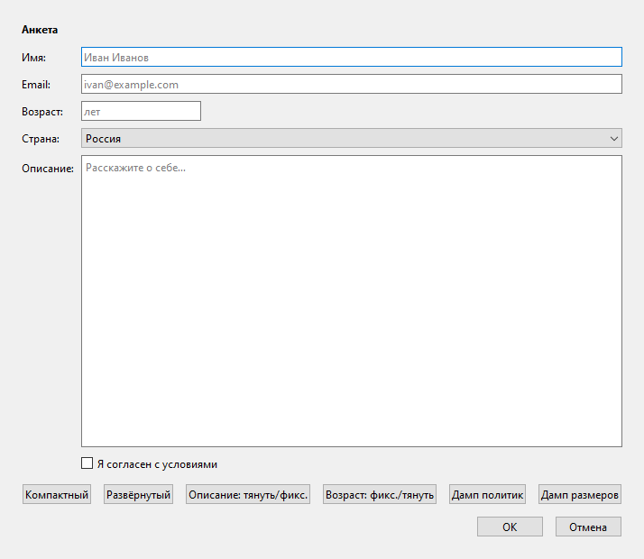
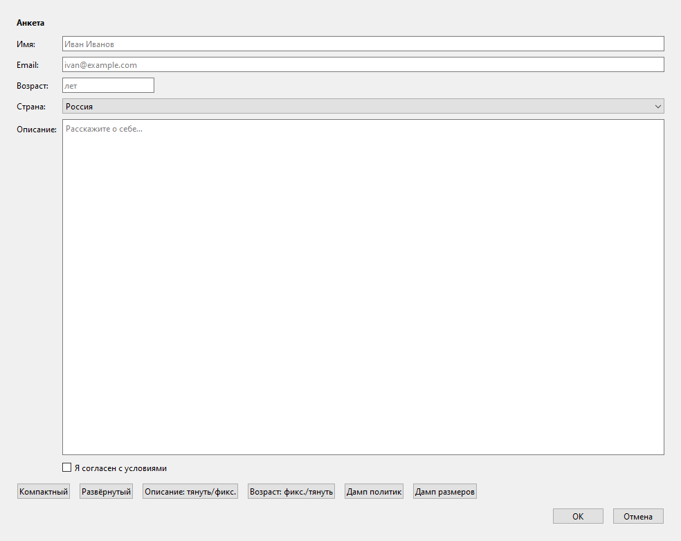
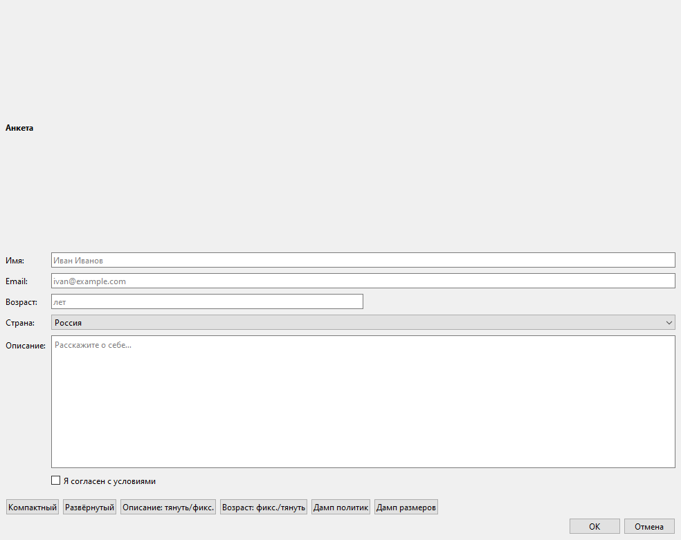

# Лабораторная работа №4. Размерные политики и адаптивные интерфейсы в Qt Widgets

## Описание

**AdaptiveForm** — окно-анкета на `QFormLayout` (имя, email, возраст,
страна, описание, согласие), которое корректно меняет компоновку при
растяжении и сжатии окна.

- Поля «Имя», «Email», «Страна» тянутся по ширине (`Expanding`),
  по высоте зафиксированы (`Fixed`).
- «Описание» тянется в обе стороны и забирает свободное место по высоте.
- «Возраст» зафиксирован по ширине (`Fixed`) и прижат влево пружиной
  `addStretch()` внутри строки формы.
- Панель режимов прижата влево, кнопки «ОК / Отмена» — вправо
  (тоже через `addStretch()`).
- Отступы окна задаёт только основной layout: у вложенного
  `QFormLayout` margins обнулены, поэтому двойных отступов нет.
- Поля `AdaptiveLineEdit` / `AdaptiveTextEdit` переопределяют
  `resizeEvent()` и печатают свой размер. `Q_OBJECT` у них нет: для
  переопределения событий он не нужен, в отличие от `FormWindow`,
  у которого есть слоты.

## Структура проекта

```
AdaptiveForm/
├── .gitignore
├── README.md
├── AdaptiveForm.pro
├── main.cpp
├── adaptivefield.h      поля с логом resizeEvent и сменой политик
├── adaptivefield.cpp
├── formwindow.h         окно-анкета, режимы, дампы
├── formwindow.cpp
└── screenshots/
```

## Сборка и запуск

Требуется Qt 6 (проверено на Qt 6.12.0, MinGW 64-bit).

**Qt Creator:** открыть `AdaptiveForm.pro`, выбрать комплект
*Desktop Qt 6.12.0 MinGW 64-bit*, затем Build → Clean All →
Run qmake → Rebuild All → Run.

**Командная строка (Windows):**

```bat
set PATH=C:\Qt\6.12.0\mingw_64\bin;C:\Qt\Tools\mingw1310_64\bin;%PATH%
mkdir build
cd build
qmake ..\AdaptiveForm.pro
mingw32-make
release\AdaptiveForm.exe
```

Путь `C:\Qt` заменить на каталог, куда установлен Qt. Благодаря
`CONFIG += console` вместе с окном открывается консоль с логом.

## Кнопки и режимы

| Кнопка | Действие |
|---|---|
| Компактный | margins = 8, spacing = 4 у основного layout |
| Развёрнутый | margins = 24, spacing = 12 (режим при запуске) |
| Описание: тянуть/фикс. | вертикальная политика описания `Expanding` ↔ `Fixed` |
| Возраст: фикс./тянуть | горизонтальная политика возраста `Fixed` ↔ `Expanding` |
| Дамп политик | вывести горизонтальную и вертикальную политику всех полей |
| Дамп размеров | вывести текущий размер, `sizeHint()` и `minimumSizeHint()` |
| ОК | вывести введённые данные и закрыть окно |
| Отмена | закрыть окно |

## Пример работы

Окно после запуска:



Окно растянуто: «Имя», «Email», «Страна» и «Описание» выросли,
«Возраст» остался прежней ширины, «ОК / Отмена» остались справа:



Компактный режим, «Описание» переключено в `Fixed`, «Возраст» —
в `Expanding`. Свободная высота больше не уходит в описание, а возраст
делит ширину строки поровну с пружиной `addStretch()`:



### Лог [RESIZE]

```
[INIT] окно создано; растяните его и смотрите [RESIZE] в логе
[RESIZE] окно -> 714 x 620 | описание: 600 x 324
[RESIZE] "Имя" -> 600 x 22
[RESIZE] "Email" -> 600 x 22
[RESIZE] "Возраст" -> 133 x 22
[RESIZE] "Описание" -> 598 x 322
[RESIZE] "Имя" -> 870 x 22
[RESIZE] "Email" -> 870 x 22
[RESIZE] "Описание" -> 868 x 483
[RESIZE] окно -> 984 x 781 | описание: 870 x 485
```

При растяжении окна «Возраст» не печатает новый размер: он `Fixed`.

### Дамп политик

```
===== ДАМП ПОЛИТИК =====
  Имя (QLineEdit) horiz=Expanding vert=Fixed
  Email (QLineEdit) horiz=Expanding vert=Fixed
  Возраст (QLineEdit) horiz=Fixed vert=Fixed
  Страна (QComboBox) horiz=Expanding vert=Fixed
  Описание (QPlainTextEdit) horiz=Expanding vert=Expanding
  Согласие (QCheckBox) horiz=Fixed vert=Fixed
========================
```

### Дамп размеров до и после растяжения окна

```
===== ДАМП РАЗМЕРОВ (текущий | sizeHint | minHint) =====
  Имя cur=600x22 hint=133x22 min=55x22
  Возраст cur=133x22 hint=133x22 min=55x22
  Описание cur=600x324 hint=256x192 min=71x71
  ...
===== ДАМП РАЗМЕРОВ (текущий | sizeHint | minHint) =====
  Имя cur=870x22 hint=133x22 min=55x22
  Возраст cur=133x22 hint=133x22 min=55x22
  Описание cur=870x485 hint=256x192 min=71x71
  ...
```

У `Expanding`-полей текущий размер намного больше `sizeHint`, у
`Fixed`-поля «Возраст» он всегда равен `sizeHint` (133 пикселя).

## Контрольные вопросы

### 1. Как заставить поле ввода тянуться по ширине вместе с окном?

Задать горизонтальную политику `QSizePolicy::Expanding` и положить
поле в layout:
`setSizePolicy(QSizePolicy::Expanding, QSizePolicy::Fixed)`.

### 2. Как прижать кнопки «ОК / Отмена» к правому краю?

Положить их в `QHBoxLayout` и перед ними вызвать `addStretch()`.
Пружина заберёт всё свободное место слева, а кнопки останутся
размером `sizeHint`.

### 3. Как задать растущий зазор между группами, а как фиксированный?

Растущий — `addStretch()` (пружина с политикой `Expanding`).
Фиксированный — `addSpacing(px)`, он не тянется.

### 4. Как задать размер, ниже которого layout не сожмёт виджет?

Через `setMinimumSize()` / `setMinimumWidth()` / `setMinimumHeight()`.
Ниже `minimumSizeHint()` layout виджет и так не сжимает, а политики
`Fixed`, `Minimum`, `MinimumExpanding` не дают сжать его ниже
`sizeHint()`.

### 5. Как уменьшить отступы от краёв окна до содержимого?

Вызвать `setContentsMargins(left, top, right, bottom)` у основного
layout окна, как в режиме «Компактный».

### 6. Как убрать двойные отступы во вложенной форме?

Обнулить margins у вложенного layout:
`m_formLayout->setContentsMargins(0, 0, 0, 0)`. Тогда отступы задаёт
только внешний layout.

### 7. Как построить двухколоночную форму «подпись: поле»?

С помощью `QFormLayout` и метода `addRow(подпись, поле)`: подпись
попадает в левую колонку, поле — в правую.

### 8. Как оставить в форме одно поле коротким, а остальные тянущимися?

Задать короткому полю горизонтальную политику `Fixed`, положить его
в `QHBoxLayout` вместе с `addStretch()` и добавить этот layout строкой
формы через `addRow(подпись, layout)`. Остальным полям — `Expanding`.

### 9. Как поменять политику «на лету», чтобы эффект наступил сразу?

Вызвать `setSizePolicy()` с новой политикой и затем `updateGeometry()`,
чтобы layout сразу пересчитал размеры.

### 10. Как заставить многострочное поле расти по высоте вместе с окном?

Задать ему вертикальную политику `QSizePolicy::Expanding`. Тогда всё
свободное место по высоте уйдёт в это поле.

### 11. Как в логе убедиться, что поле реально меняется при растяжении?

Переопределить у поля `resizeEvent()` и выводить в `qDebug()` новый
размер `event->size()`. Если поле тянется, при растяжении окна
появляются строки `[RESIZE]` с новыми размерами.

### 12. Как вывести текущие политики и размеры всех полей?

Хранить поля в списке и по кнопке выводить для каждого
`sizePolicy().horizontalPolicy()` / `verticalPolicy()`, а также
`width()`, `height()`, `sizeHint()` и `minimumSizeHint()`, как
в «Дамп политик» и «Дамп размеров».
